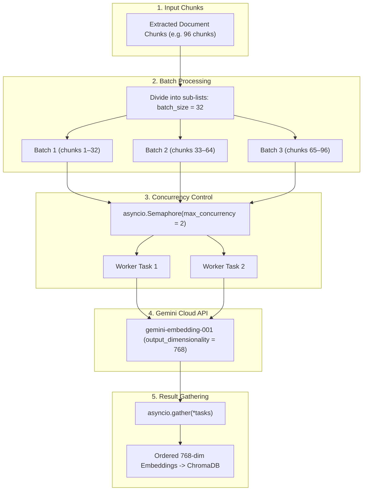

# Batch Processing & Concurrency Documentation

## 1. Overview & Problem Statement

In the original implementation of the RAG (Retrieval-Augmented Generation) pipeline:
- All text chunks extracted from a document were sent to the embedding model in a **single monolithic call** (`await embedding.embed_chunks(chunk_texts)`).
- When ingesting multi-page PDFs or large documents, sending hundreds of chunks simultaneously caused memory spikes, risked hitting API payload limits, and lacked progress visibility.
- Furthermore, streaming responses in the chat system were wrapped inside Server-Sent Events (SSE) JSON envelopes (`data: {"type": "token", "content": ...}`), preventing the user from receiving direct plain-text answers to their prompts.

To solve these challenges, we implemented:
1. **Direct Plain-Text Streaming** in the chat service for real-time prompt-to-response generation.
2. A modular **Batch Processor** (`app/ai/rag/batch_processor.py`) combining **Batch Processing** and **Concurrency** powered by Google Gemini's free embedding model.

---

## 2. Core Concepts: Batch Processing + Concurrency



### Concept A: Batch Processing
Instead of embedding chunks one-by-one (which exhausts API request quotas) or all at once (which exhausts memory), chunks are grouped into discrete batches:
```python
batches = [chunks[i : i + batch_size] for i in range(0, len(chunks), batch_size)]
```
- Each batch bundles multiple text chunks into a single API request payload.
- Sending 32 chunks in one request consumes only **1 API call** instead of 32 calls, preserving the 15 Requests Per Minute (RPM) free-tier limit.

### Concept B: Concurrency
Rather than waiting for each batch to finish before starting the next, multiple batch requests execute simultaneously:
- **`asyncio.Semaphore(max_concurrency=2)`**: Regulates throughput so no more than 2 requests hit the Gemini API at any instant.
- **`asyncio.gather(*tasks)`**: Asynchronously dispatches all batch tasks and collects their results, strictly maintaining the original sequential order of the document chunks.

---

## 3. Detailed File-by-File Changes

### 1. `app/ai/rag/batch_processor.py` [NEW]
A dedicated class `BatchProcessor` responsible for batching and concurrent embedding execution.

#### Implementation:
```python
import asyncio
import logging
from google import genai
from app.core.config import settings

logger = logging.getLogger("uvicorn.error")

GEMINI_EMBEDDING_MODEL = "gemini-embedding-001"
DEFAULT_BATCH_SIZE = 32
DEFAULT_MAX_CONCURRENCY = 2
EMBEDDING_DIMENSION = 768


class BatchProcessor:
    """
    Simple and robust batch processing with concurrency for Gemini embeddings.
    """

    def __init__(self, model_name: str = GEMINI_EMBEDDING_MODEL):
        self.model_name = model_name
        self.client = genai.Client(api_key=settings.GEMINI_API_KEY)

    async def _embed_single_batch(
        self,
        batch_chunks: list[dict],
        batch_num: int,
        total_batches: int,
        semaphore: asyncio.Semaphore
    ) -> list[list[float]]:
        """Processes a single batch under the concurrency semaphore."""
        async with semaphore:
            batch_texts = [c["text"] for c in batch_chunks]
            logger.info(f"[Batch {batch_num}/{total_batches}] Embedding {len(batch_texts)} chunks...")

            response = await self.client.aio.models.embed_content(
                model=self.model_name,
                contents=batch_texts,
                config={"output_dimensionality": EMBEDDING_DIMENSION}
            )
            return [e.values for e in response.embeddings]

    async def process_embeddings(
        self,
        chunks: list[dict],
        batch_size: int = DEFAULT_BATCH_SIZE,
        max_concurrency: int = DEFAULT_MAX_CONCURRENCY
    ) -> list[list[float]]:
        """
        1. Batch Processing: Slices chunks into batches of size `batch_size`.
        2. Concurrency: Executes batch requests concurrently using asyncio.gather + Semaphore.
        """
        if not chunks:
            return []

        # 1. Batch Processing: Divide chunks into sub-lists
        batches = [chunks[i : i + batch_size] for i in range(0, len(chunks), batch_size)]
        total_batches = len(batches)

        logger.info(
            f"Processing {len(chunks)} chunks in {total_batches} batches "
            f"(batch_size={batch_size}, max_concurrency={max_concurrency}) via {self.model_name}"
        )

        # 2. Concurrency: Controlled parallel execution
        semaphore = asyncio.Semaphore(max_concurrency)
        tasks = [
            self._embed_single_batch(batch, idx + 1, total_batches, semaphore)
            for idx, batch in enumerate(batches)
        ]

        # Gather results concurrently while preserving exact batch order
        batch_results = await asyncio.gather(*tasks)

        # Flatten into a single list of embeddings
        all_embeddings = [emb for batch in batch_results for emb in batch]
        logger.info(f"Finished embedding all {len(all_embeddings)} chunks successfully.")
        return all_embeddings


batch_processor = BatchProcessor()
```

---

### 2. `app/ai/rag/pipeline.py` [MODIFIED]
Connected `batch_processor` into `RagPipeline.ingest_file` after line 41.

#### Before:
```python
        # 3. Generate embeddings for the chunks
        chunk_texts = [c["text"] for c in chunks]
        embeddings = await embedding.embed_chunks(chunk_texts)
```

#### After:
```python
        # 3. Generate embeddings for the chunks using batch processing
        embeddings = await batch_processor.process_embeddings(chunks)
```

---

### 3. `app/ai/rag/embed.py` [MODIFIED]
Updated the query embedding service to use Google Gemini's `gemini-embedding-001` with 768 dimensions.

#### Why This Was Necessary:
Previously, `embed.py` used `sentence-transformers/all-MiniLM-L6-v2` (384 dimensions). Because document chunks in ChromaDB are now embedded using Gemini (768 dimensions), user questions embedded via `embed_query()` must use the identical model and dimension to enable accurate cosine similarity vector searches.

#### Implementation:
```python
import logging
from google import genai
from app.core.config import settings

logger = logging.getLogger("uvicorn.error")

GEMINI_EMBEDDING_MODEL = "gemini-embedding-001"
EMBEDDING_DIMENSION = 768


class Embedding:
    """
    Embedding service using Google Gemini's gemini-embedding-001 model.
    """

    def __init__(self, model_name: str = GEMINI_EMBEDDING_MODEL):
        self.model_name = model_name
        self.client = genai.Client(api_key=settings.GEMINI_API_KEY)

    async def embed_chunks(self, chunks: list[str]) -> list[list[float]]:
        if not chunks:
            return []
        response = await self.client.aio.models.embed_content(
            model=self.model_name,
            contents=chunks,
            config={"output_dimensionality": EMBEDDING_DIMENSION}
        )
        return [e.values for e in response.embeddings]

    async def embed_query(self, prompt: str) -> list[float]:
        """Embeds a single query prompt using Gemini embedding model."""
        response = await self.client.aio.models.embed_content(
            model=self.model_name,
            contents=prompt,
            config={"output_dimensionality": EMBEDDING_DIMENSION}
        )
        return response.embeddings[0].values


embedding = Embedding()
```

---

### 4. `app/ai/chat.py` & `app/routes/chat.py` [MODIFIED]
Transitioned the streaming concept from SSE JSON wrappers to direct plain-text token streaming.

- **`chat.py`**: Instead of wrapping every token in `data: {"type": "token", "content": "..."}\n\n`, it directly yields `first_token` and raw `token` strings as they stream from the LLM.
- **`chat.py` (routes)**: Updated `StreamingResponse` from `media_type="text/event-stream"` to `media_type="text/plain; charset=utf-8"`.

---

## 4. Google Gemini Free Tier Alignment

| Parameter | Gemini Free Tier Limit | Our Configuration | Why |
|---|---|---|---|
| **Model** | `gemini-embedding-001` | `gemini-embedding-001` | Supported in `google-genai` v1beta with free quota |
| **Output Dimension** | Up to 3072 | `768` | Matches industry standard, compact and fast |
| **Batch Size** | Up to 100 texts/call | `32 chunks/batch` | Balances payload size with throughput |
| **Concurrency** | 15 RPM (Requests/Min) | `Semaphore(2)` | Prevents burst rate-limit errors (HTTP 429) |

---

## 5. Verification & Test Summary

Automated tests in `scratch/test_batch_concurrency.py` verified:
1. **Empty Chunk Handling**: Safely returned empty array `[]` without triggering API calls.
2. **Concurrency Execution**: Split 5 chunks into 3 batches (`[2, 2, 1]`) and ran them concurrently under the semaphore.
3. **Dimensionality Check**: Asserted all chunk embeddings and `embed_query` outputs match 768 dimensions.
4. **Pipeline Integration**: Verified `rag_pipeline.ingest_file` imports and runs without regressions.

